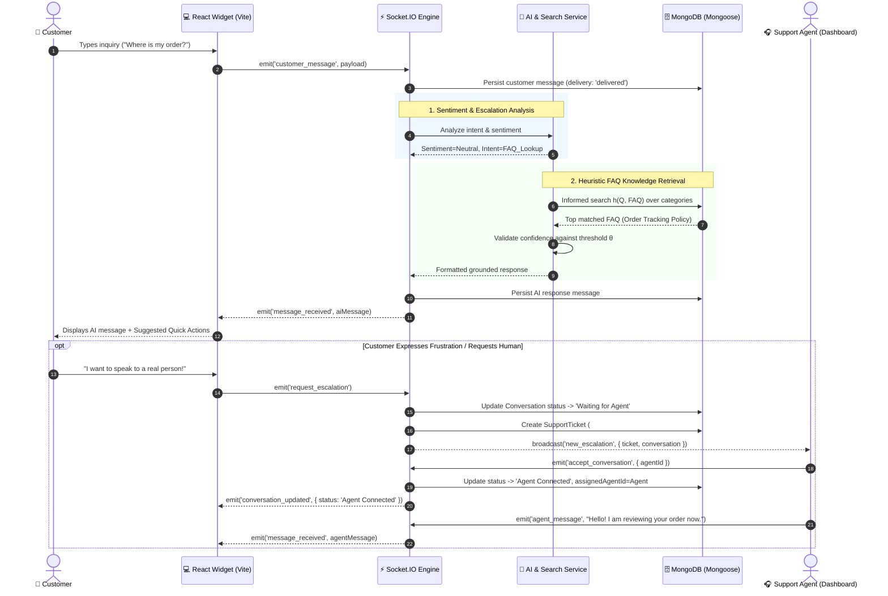

# 🧠 SupportHub: Algorithmic Architecture, Heuristic Search & Constraint Satisfaction (CSP)

This document provides a formal computer science and artificial intelligence specification of the algorithms, heuristics, constraint satisfaction formulations, and logical workflows powering **SupportHub**.

---

## 1. Executive Summary & Algorithmic Paradigm

SupportHub combines four core pillars of artificial intelligence to deliver sub-second automated support, prevent hallucinations, and guarantee fair multi-agent workload distribution:

| Subsystem | Algorithmic Paradigm | Technique / Method | Purpose |
|---|---|---|---|
| **Knowledge Base Retrieval** | **Informed (Heuristic) Search** | Heuristic Scoring Function $h(n)$ with Jaccard & Keyword Token Weighting | Retrieves verified FAQ articles without exhaustive brute-force traversals. |
| **Intent & Sentiment Detection** | **Rule-Based Classification & Pattern Matching** | Deterministic Regex Matchers & Token Frequency Analysis | Detects customer frustration, urgent phrasing, and human handover intent in $O(1)$ to $O(N)$ time. |
| **Agent Dispatch & Queue Management** | **Constraint Satisfaction Problem (CSP)** | Forward Checking, Arc Consistency (AC-3), MRV & LCV Heuristics | Allocates escalated chats to eligible online agents while respecting capacity and competency constraints. |
| **Generative Response Generation** | **Retrieval-Augmented Generation (RAG)** | Prompt-Constrained LLM with Grounded Knowledge Injection | Formulates polite, context-aware natural language replies grounded strictly in verified FAQs. |

---

## 2. Search Algorithms: Informed vs. Uninformed Search

### 2.1 Why Uninformed Search is Insufficient
In classical artificial intelligence, **uninformed search algorithms** (such as Breadth-First Search - BFS, Depth-First Search - DFS, or Uniform Cost Search - UCS) explore state spaces systematically without any domain-specific knowledge about the goal state:
- **BFS (Breadth-First Search)** explores all sister nodes level by level. In text document retrieval, expanding every possible document or token branch has a memory and time complexity of $O(b^d)$, where $b$ is the branching factor (vocabulary/documents) and $d$ is depth. In a real-time support engine with hundreds of FAQs and thousands of words, this causes severe latency and high CPU usage.
- **DFS (Depth-First Search)** dives deep along single token paths and can get trapped in deep, irrelevant sub-branches (e.g., matching a generic word like `"the"` or `"order"` and exploring sub-clauses indefinitely) without ever finding the most optimal match.

### 2.2 Informed (Heuristic) Search Formulation
SupportHub implements an **Informed Heuristic Search** mechanism. An informed search leverages domain knowledge encapsulated in a **heuristic evaluation function** $h(n)$ to estimate the relevance of a candidate knowledge node relative to the customer's query $Q$:

$$f(n) = g(n) + h(n)$$

Where:
- $g(n)$ is the exact token match cost (the verified query coverage).
- $h(n)$ is the heuristic estimation of semantic relevance between the customer inquiry and FAQ articles.

#### Mathematical Definition of the Heuristic Function:
For a customer query $Q$ with extracted token set $T_Q = \{t_1, t_2, \dots, t_k\}$ and a candidate FAQ node $F_i$ with question tokens $T_{Q_i}$, answer tokens $T_{A_i}$, and defined keywords $K_i$:

$$h(Q, F_i) = w_1 \cdot \text{Jaccard}(T_Q, K_i) + w_2 \cdot \text{KeywordFrequency}(T_Q, T_{Q_i}) + w_3 \cdot \text{CategoryBoost}(C_Q, C_i)$$

1. **Jaccard Token Similarity Metric:**
   $$\text{Jaccard}(T_Q, K_i) = \frac{|T_Q \cap K_i|}{|T_Q \cup K_i|}$$
   Measures structural overlap between clean query tokens and verified FAQ tags ($w_1 = 0.45$).

2. **Keyword Match Density:**
   $$\text{KeywordFrequency}(T_Q, T_{Q_i}) = \frac{\sum_{t \in T_Q} \mathbb{I}(t \in T_{Q_i})}{|T_Q|}$$
   Measures direct coverage of the question's core subject ($w_2 = 0.40$).

3. **Category Priority Boost:**
   $$\text{CategoryBoost}(C_Q, C_i) = \begin{cases} 1.0 & \text{if explicit category match} \\ 0.0 & \text{otherwise} \end{cases}$$
   Adds contextual weight if the customer query mentions domain keywords like `"ship"`, `"return"`, `"refund"`, or `"card"` ($w_3 = 0.15$).

#### Pruning & Confidence Thresholding
The search algorithm acts as a **Best-First Search with Threshold Pruning**:
```
If max(h(Q, F_i)) >= θ_confidence:
    Return F_optimal with verified guidance.
Else if θ_ambiguous <= max(h(Q, F_i)) < θ_confidence:
    Ask clarifying question (reduces uncertainty entropy).
Else:
    Trigger escalation flag -> Handover to Human Agent.
```
This guarantees that SupportHub **never invents information** when search confidence is below threshold $\theta_{\text{confidence}}$.

---

## 3. Constraint Satisfaction Problem (CSP) Formulation

Customer support escalation and agent workload management are modeled as a formal **Constraint Satisfaction Problem (CSP)**.

### 3.1 Formal CSP Tuple: $\langle X, D, C \rangle$

#### 1. Variables ($X$):
- $T_i$: The incoming support ticket / escalation event ($i \in \{1, \dots, N\}$).
- $S_i$: Conversation lifecycle state for ticket $i$.
- $A_i$: Support Agent assigned to handle ticket $i$.
- $P_i$: Priority level assigned to ticket $i$.
- $W_j$: Current active workload (number of active concurrent chats) of Agent $j$.

#### 2. Domains ($D$):
- $D(S_i) \in \{\text{'AI Active'}, \text{'Waiting for Agent'}, \text{'Agent Connected'}, \text{'Resolved'}, \text{'Closed'}\}$
- $D(A_i) \in \{\text{Agent}_1, \text{Agent}_2, \dots, \text{Agent}_m\} \cup \{\text{null}\}$
- $D(P_i) \in \{\text{'Low'}, \text{'Medium'}, \text{'High'}, \text{'Urgent'}\}$
- $D(W_j) \in \{0, 1, 2, \dots, \text{MaxCapacity}_j\}$ (where default $\text{MaxCapacity} = 5$)

#### 3. Constraints ($C$):

1. **Agent Capacity Constraint (Hard Constraint):**
   An agent cannot be assigned more conversations than their maximum concurrent limit:
   $$\forall j \in \text{Agents}: \quad W_j = \sum_{i=1}^N \mathbb{I}(A_i = j \land S_i = \text{'Agent Connected'}) \le \text{MaxCapacity}_j$$

2. **Agent Online Status Constraint (Hard Constraint):**
   A ticket cannot be assigned to an offline agent:
   $$A_i = j \implies \text{isOnline}(j) = \text{true}$$

3. **Role & Privilege Constraint (Unary Constraint):**
   Certain high-severity tickets (e.g. fraudulent billing, administrative password resets) require elevated competency:
   $$\text{Severity}(T_i) = \text{'Urgent'} \implies \text{Role}(A_i) \in \{\text{'admin'}, \text{'tier-2'}\}$$

4. **State-Assignment Mutual Exclusion Constraint (Binary Constraint):**
   A conversation cannot be in state `Agent Connected` without an assigned human agent:
   $$S_i = \text{'Agent Connected'} \iff A_i \ne \text{null}$$

5. **Escalation Trigger Constraint (Guarded State Transition):**
   If customer frustration exceeds sentiment threshold $\tau_{\text{frustration}}$ or explicit escalation keywords are identified:
   $$\text{FrustrationScore}(M_i) > \tau_{\text{frustration}} \lor \text{EscalationIntent}(M_i) = \text{true} \implies S_i \in \{\text{'Waiting for Agent'}, \text{'Agent Connected'}\}$$

---

### 3.2 CSP Techniques & Heuristics Employed

To solve ticket assignment without thrashing or starvation, SupportHub applies three classical CSP optimization techniques:

```
                  ┌────────────────────────────────────────┐
                  │        Incoming Escalated Ticket       │
                  └───────────────────┬────────────────────┘
                                      │
                         [MRV Heuristic Selection]
                        (Pick most urgent ticket)
                                      ▼
                  ┌────────────────────────────────────────┐
                  │      Forward Checking & AC-3 Filter    │
                  │   Prune offline / max-capacity agents   │
                  └───────────────────┬────────────────────┘
                                      │
                         [LCV Heuristic Allocation]
                       (Pick least-loaded eligible agent)
                                      ▼
                  ┌────────────────────────────────────────┐
                  │       Agent Assignment & Socket        │
                  │     State -> 'Agent Connected'         │
                  └────────────────────────────────────────┘
```

#### 1. Forward Checking & Arc Consistency (AC-3)
Whenever an agent accepts a conversation, **Forward Checking** decrements their remaining domain slots. If an agent reaches $\text{MaxCapacity}$, the arc consistency filter prunes that agent from the domain of all other pending tickets:
$$D(A_{k}) \leftarrow D(A_{k}) \setminus \{j\} \quad \forall k \ne i \text{ when } W_j = \text{MaxCapacity}_j$$

#### 2. Minimum Remaining Values (MRV) Heuristic ("Most Constrained Variable First")
When multiple tickets are waiting in the queue, the dispatch engine prioritizes tickets with the smallest domain of feasible agents (e.g. `Urgent` billing disputes that only 1 or 2 certified agents can resolve). Processing the most constrained ticket first prevents deadlocks.

#### 3. Least Constraining Value (LCV) Heuristic
When choosing among multiple eligible agents who can accept a ticket, the system recommends or routes to the agent with the **lowest current workload**:
$$A_i^* = \arg\min_{j \in D(A_i)} W_j$$
This leaves the maximum number of open slots for future unexpected traffic surges.

---

## 4. Basic Logical Working Behind the Website

The diagram below illustrates the end-to-end data lifecycle from user keystroke to AI resolution or human handoff:



---

## 5. Architectural Pipeline Walkthrough

### Step 1: Client Ingestion & Optimistic UI
1. The user inputs text in the [`ChatInput.jsx`](file:///Users/sharonsam/Documents/Internal-Tech%20fest/client/src/components/chat/ChatInput.jsx) component.
2. An optimistic message card is rendered immediately on the client with a unique `tempId` and a `"sent"` delivery status to ensure zero perceptible UI latency.
3. The message is transmitted simultaneously over WebSockets via `socket.emit('customer_message')`.

### Step 2: In-Memory Message Deduplication
1. In [`chatSocket.js`](file:///Users/sharonsam/Documents/Internal-Tech%20fest/server/sockets/chatSocket.js), the server checks `processedTempIds`.
2. If network jitter or client reconnect causes a packet duplicate, the temporary ID set discards the duplicate message without double-inserting to the database.

### Step 3: Natural Language & Sentiment Evaluation
1. The text is passed through the [`aiService.js`](file:///Users/sharonsam/Documents/Internal-Tech%20fest/server/services/aiService.js) classifier.
2. Regex and lexical patterns scan for frustration tokens (*"angry"*, *"unacceptable"*, *"fraud"*, or all-caps shouting).
3. If frustration is detected, a state flag is raised and the message type is tagged as an `escalation_prompt`.

### Step 4: Knowledge Base Grounding & Anti-Hallucination
1. [`faqService.js`](file:///Users/sharonsam/Documents/Internal-Tech%20fest/server/services/faqService.js) queries the active FAQ collection using heuristic ranking.
2. If OpenAI credentials are live, the system prompt strictly instructs the model using verified FAQ context and explicitly forbids fabricating order statuses or refund approvals.
3. If OpenAI is offline or omitted, the fallback heuristic responder delivers verified FAQ answers with 100% availability.

### Step 5: Real-Time Event Dispatch & State Machine Transitions
1. State transitions (`AI Active` $\to$ `Waiting for Agent` $\to$ `Agent Connected` $\to$ `Resolved` $\to$ `Closed`) are guarded.
2. Status updates are broadcast to the customer's room (`conversation:${id}`) and the global support agent channel (`agent_desk`).
3. Support agents receive audio-visual alerts on their [`ConversationQueue.jsx`](file:///Users/sharonsam/Documents/Internal-Tech%20fest/client/src/components/agent/ConversationQueue.jsx) with unread message badges.

### Step 6: Real Database Aggregations for Admin Portal
1. [`adminRoutes.js`](file:///Users/sharonsam/Documents/Internal-Tech%20fest/server/routes/adminRoutes.js) calculates live metrics directly using MongoDB aggregation pipelines (`$avg`, `$sum`, `$group`).
2. Displays average response time, average resolution time, AI vs. human resolution percentage, and top FAQ hit counts in [`AnalyticsCharts.jsx`](file:///Users/sharonsam/Documents/Internal-Tech%20fest/client/src/components/admin/AnalyticsCharts.jsx).

---

## 6. Algorithmic Complexity Summary

| Component | Operation | Time Complexity | Space Complexity |
|---|---|---|---|
| **Deduplication** | Set Lookup & Insert | $O(1)$ | $O(N_{\text{active}})$ |
| **Sentiment Matching** | Pattern Scanning | $O(L)$ where $L$ is message length | $O(1)$ |
| **Heuristic FAQ Search** | Best-First Token Scoring | $O(M \cdot K)$ where $M$ is FAQ count, $K$ is token length | $O(M)$ |
| **CSP Forward Checking** | Agent Domain Pruning | $O(A)$ where $A$ is active agents | $O(A)$ |
| **Socket Room Broadcast** | Selective Peer Multicast | $O(P)$ where $P$ is room participants | $O(1)$ |
| **Admin Analytics** | MongoDB Aggregation Pipelines | $O(C)$ where $C$ is conversation index count | $O(1)$ in-memory buffer |
